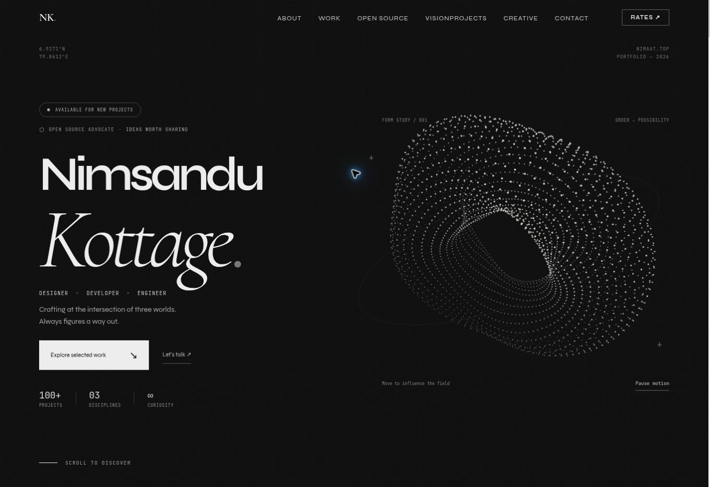

# Kinetic portfolio edition

This upgrade extends the existing monochrome editorial design with a 3D particle field, a featured FoE-SemApp presentation, and an updated project index. The site remains plain HTML, CSS and JavaScript and can be served directly through GitHub Pages.

## Files

- `index.html`: existing portfolio content, new hero, SemApp feature and project index.
- `index.css`: retained original design system.
- `experience.css`: monochrome tokens, kinetic edition styles and responsive layouts.
- `index.js`: dependency-free interactions and 3D projection onto a 2D canvas.
- `img/semapp-placeholder.svg`: intentionally illustrative artwork, not actual application UI.

## Replace the SemApp image

Add your screenshot to `img/`, then change the `src` and `alt` of the image inside `.semapp-stage` in `index.html`. Remove the “image coming soon” caption when using the real screenshot. `object-fit: contain` preserves the entire image.

## Interaction details

The particle field rotates slowly, responds to pointer movement and ripples when pressed. Its render loop stops outside the viewport, when the document is hidden, or when paused. Rendering is capped near 30 frames per second and device pixel ratio is capped at 1.7. The operating system's reduced-motion preference disables animation by default; the explicit control permits resuming it.

Project filters use semantic buttons with pressed state and a live result count. All nine HTML applications currently in `pro/` are linked, alongside VisionTPC and Countries Explorer. FoE-SemApp links to https://semapp.nimaat.top and is described with React, Vite, Firebase, native Android notifications, biometrics, widgets, PWA support and real-time synchronization.

The creative image viewer supports keyboard activation, Escape, trapped modal focus and focus restoration. The mobile navigation keeps hidden links out of the tab order and closes after navigation. Content remains readable if JavaScript is unavailable.

## Validation

- JavaScript syntax: `node --check index.js`.
- Source checks: local links and assets exist; section anchors resolve; IDs are unique; no nested anchors; all `pro/*.html` projects are listed.
- Whitespace: `git -c core.whitespace=cr-at-eol diff --check` (original HTML uses CRLF).
- Browser QA: desktop hero and SemApp layouts, motion toggle, all/experiment filters (11/4 results), creative gallery open/Escape close, 390px embedded mobile viewport, mobile menu open/navigation/close, mobile horizontal overflow and image loading.
- Existing project applications, custom-domain configuration and auxiliary pages are retained.

The retained third-party analytics script and external font loading are unchanged. Existing figures and claims in the older open-source and VisionProjects sections are retained from the previous site. This change does not add a live GitHub statistics integration.
