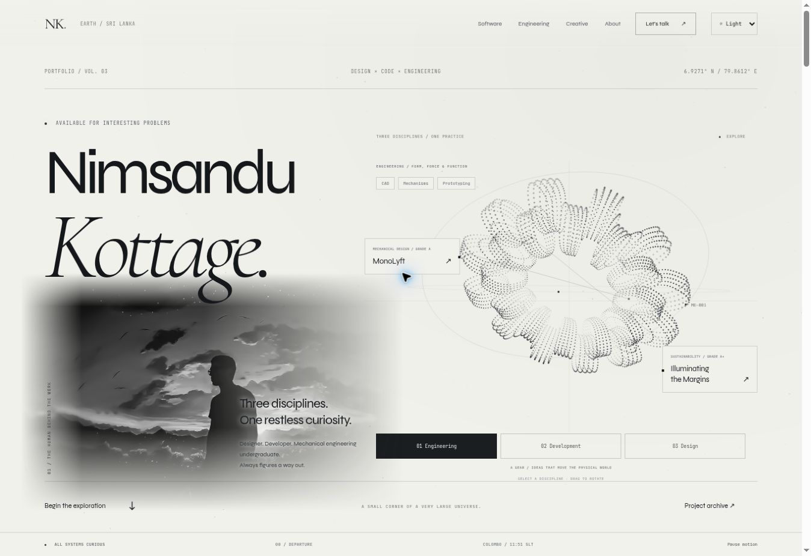
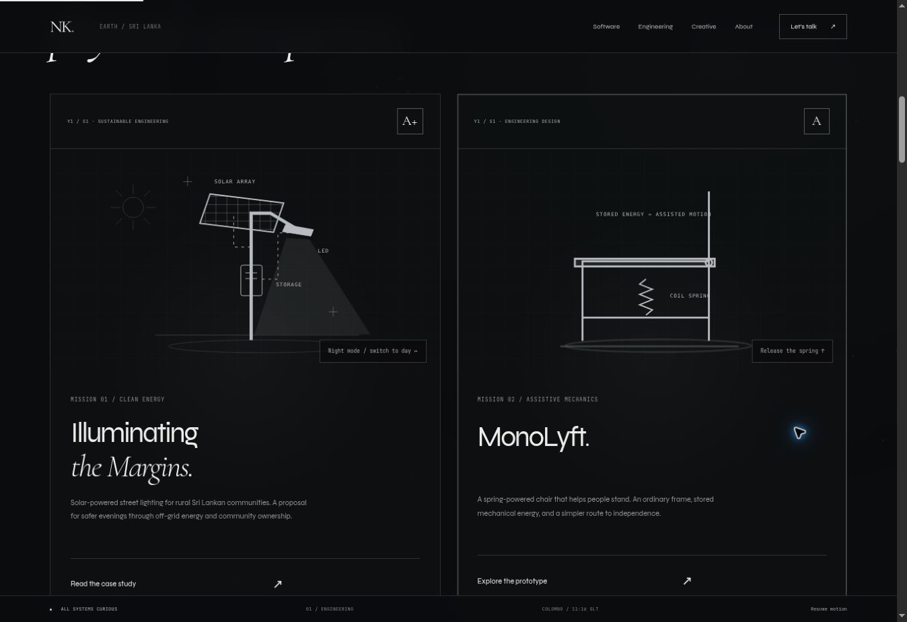

# Mission portfolio

A complete redesign of the portfolio around a monochrome mission-through-space aesthetic. The main site, software archive and engineering case studies share navigation, typography, a star field, motion settings and a mission status bar. Day and night palettes now apply across these pages, with the same time-based theme selector on Rates & Policies. It remains a static site, with no build step or runtime dependencies.






## Pages

- `/`: portrait-led landing, interactive orbital sculpture, engineering projects, featured software, interactive discipline console, open source, creative gallery and contact.
- `/work.html`: software archive. Ten project entries plus the featured FoE-SemApp make eleven software projects. Category filters operate on the ten-entry index.
- `/engineering/illuminating-margins.html`: a simple case study with the A+ result, project summary, team-photo placeholder, report area, and the original interactive overview in an expandable iframe. A separate link opens the overview in a new tab.
- `/pro/monolyft/`: the user's complete case study, reframed in the shared mission shell. Its text, prototype photographs, results and working spring demo are retained. The homepage records its Y1S1 grade A.
- `/pro/asg-sus.html`: the original interactive overview, retained unchanged.

## Asset handoff

Edit `mission-config.js` after adding the assets:

```js
window.MISSION_ASSETS = Object.freeze({
  semAppImage: '/img/semapp-screenshot.png',
  illuminatingReport: '/reports/illuminating-margins.pdf',
  illuminatingTeamImage: '/img/illuminating-team.jpg',
});
```

These example paths are instructions, not files included in this change. Keep a value `null` until its actual file is added. The project report PDF was not found in the repository or the available file search. The site shows an honest “coming soon” label instead of a broken download link. Once configured, the real download anchor is displayed with the `download` attribute, and the pending notice disappears. The team image and SemApp screenshot likewise replace their placeholders automatically.

## Interaction and accessibility

- The discipline explorer morphs between an engineering gear, a development cube and a design ribbon. Each selection updates relevant skills, two real project links and their connecting lines. It supports drag rotation and click disturbance, with semantic buttons and a live selection announcement.
- The portrait fades horizontally toward the scene on desktop; mobile uses a vertical fade beneath the name. The source photograph is unchanged.
- Engineering cards expose day/night solar and spring-release previews through keyboard-operable buttons.
- The discipline console switches between engineering, development and design content.
- Software filters announce their result count. Native dialog semantics provide creative preview focus handling, Escape and focus return.
- Contact supports copying the email address, with a readable fallback if clipboard access fails.
- Motion respects the system preference, can be paused, and keeps that choice for the browser session. Background-tab animation stops; the sculpture skips rendering outside the viewport. Rendering is capped near 30 FPS and 1.6 device pixel ratio, with fewer stars and particles on small screens.
- The main content remains readable without JavaScript. Mobile navigation keeps background content inert while open.

## Validation

JavaScript syntax; local routes, assets and cross-page anchors; unique IDs and no nested links. Browser checks cover desktop and 390px embedded mobile layouts, sculpture forms and pause, engineering controls, discipline switching, archive filters (10 total / 3 experiments), creative dialog open/Escape, the embedded overview and expand control, MonoLyft's original spring demo, mobile menu navigation, loaded images and horizontal overflow.

The report PDF, team photo and actual SemApp screenshot still need to be supplied. The academic grades are supplied by the user. The Illuminating summary describes the proposal and avoids presenting estimated benefits in the older interactive map as measured project outcomes.

## Day and night themes

`theme.js` runs before the stylesheet to choose the initial palette without flashing the wrong theme. Auto uses Asia/Colombo time: light from 06:00 inclusive to 18:00 exclusive; dark otherwise. It refreshes once a minute and when the page becomes visible again. Light and Dark override Auto, and the choice persists between pages and visits in local storage. Blocked or invalid storage falls back to Auto. The theme selector is visible on mobile as well as desktop.

The canvas changes its ink for each palette, including when motion is paused. `theme.css` contains the daylight styling, project-map cards, restored FractalX feature and refined contact/footer layouts. The original photo and video assets are unchanged.

## Restored film and closing chapter

The FractalX visual-storytelling video is restored with `img/vid1.png` and its exact original LinkedIn destination from the initial source. The design scene links directly to the film feature. Contact now has a single email panel, a separate copy control with a readable fallback, clear GitHub/LinkedIn/rates destinations and a compact footer.

Additional validation: automatic theme boundaries (05:59/06:00 and 17:59/18:00 Sri Lankan time), midnight, manual overrides, saved preferences, invalid settings and blocked storage; browser theme changes and persistence across pages; all three discipline-to-project mappings; restored film destination equality against the original source; desktop and 390px mobile layouts. Clipboard copying falls back gracefully when the browser denies access. Rates content and client-ID gate logic remain unchanged.
